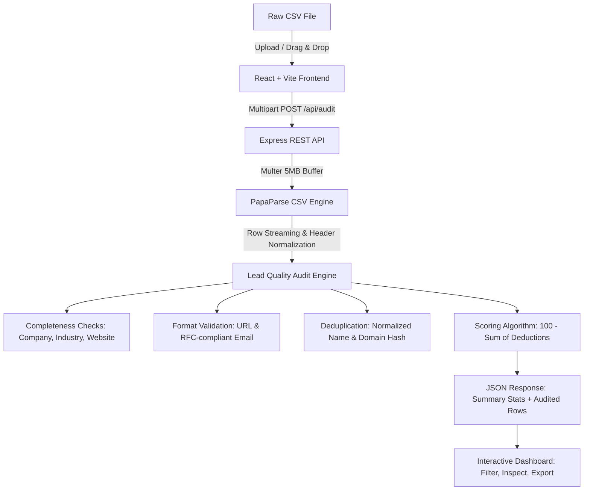

# LeadInspect — Lead Quality Inspector

[](https://www.typescriptlang.org/)
[](https://react.dev/)
[](https://vitejs.dev/)
[](https://nodejs.org/)
[](https://expressjs.com/)
[](https://opensource.org/licenses/MIT)

## Overview

**LeadInspect** is a high-performance, full-stack lead data quality auditing engine. Designed specifically for B2B lead generation, search fund sourcing, and M&A screening pipelines (such as SaaSQuatch-generated data), LeadInspect enables operators to detect incomplete, malformed, and duplicate records **before** committing them to cold email sequences or CRM databases.

Users upload a CSV file to inspect quality scores, detect formatting anomalies, review actionable recommendations per record, and export cleaned datasets or detailed error logs.

---

## Architecture Flow



---

## Core Features

- **High-Speed CSV Processing:** Drag-and-drop or file-picker upload with client-side and server-side MIME type verification.
- **Rule-Based Quality Scoring:** Deterministic 0–100 quality score per record based on data completeness and outreach readiness.
- **Entity Deduplication:** Hash-indexed duplicate detection across normalized company names and stripped domains (resolving `http://`, `https://`, and `www.` prefixes).
- **Format Sanitization & Syntax Validation:** Deep regex verification for RFC 5322 email patterns and RFC 3986 URL structures.
- **Granular Record Inspection:** Interactive drawer/modal detailing point deductions, issue severities, and operator fix recommendations.
- **Dual Export Capabilities:**
  - **Audited Results:** Complete dataset enriched with quality scores and duplicate flags.
  - **Issue Report:** Actionable triage sheet for data ops teams highlighting specific fixes and prior row references.
- **Fail-Safe Validation:** Automatic handling of empty files, missing required headers, malformed quotes, and oversized files (>5 MB).

---

## Technology Stack

| Layer | Technologies | Rationale |
| :--- | :--- | :--- |
| **Frontend** | React 18, TypeScript, Vite, Vanilla CSS | Zero runtime styling overhead, instant HMR, strict type safety across lead schemas. |
| **Icons** | Lucide React | Modern, tree-shakeable iconography. |
| **Backend** | Node.js, Express 5, TypeScript | Fast I/O, native JSON serialization, robust middleware ecosystem. |
| **File Parsing** | Multer, Papa Parse | Memory-efficient multipart handling and streaming CSV parsing with greedy empty line trimming. |

---

## Full Backend Architecture & Engineering Specifications

### 1. Data Storage & Privacy Strategy
* **Current Implementation (Stateless In-Memory Processing):**
  - Files are processed directly in Node.js memory buffers and discarded immediately after response dispatch.
  - **Benefits:** Ultra-low latency (<50ms processing for standard files), zero PII (Personally Identifiable Information) retention, compliance with GDPR/CCPA data minimization principles, and zero database maintenance overhead for lightweight auditing.
* **Production Scale Architecture (Enterprise PE Sourcing Pipeline):**
  - **Database:** **PostgreSQL** with JSONB columns for dynamic lead schemas.
    - `batches`: Stores batch ID, user ID, file name, timestamp, and summary metrics.
    - `leads`: Relational mapping of original vs. sanitized fields with indexed foreign keys.
    - `audit_issues`: Normalized table for issue tracking, severity levels, and resolution status.
  - **Blob Storage:** **AWS S3** with server-side KMS encryption for secure archival of raw uploaded CSVs and exported reports.

### 2. Caching & Performance Optimizations
* **Domain Fingerprinting Cache:** Implementation of an in-memory or **Redis** Bloom filter for sub-millisecond duplicate checks across global multi-million record lead databases.
* **Stream Parsing:** Migration from buffer-based `Papa.parse` to Node.js readable streams (`stream.Transform`) to audit 100k+ row datasets with near-constant memory footprint (O(1) memory usage).
* **Connection Pooling:** In production, pg-pool / Prisma connection pooling prevents exhaustion during concurrent audits.

### 3. Hosting & Cloud Provider Setup
* **Static Frontend:** Hosted on **AWS S3 + CloudFront CDN** or **Vercel** for edge caching, 100% uptime, and sub-100ms global Time to First Byte (TTFB).
* **API Backend:**
  - **Option A (Containerized):** **AWS ECS Fargate** behind an Application Load Balancer (ALB) with auto-scaling triggered by CPU/Memory utilization.
  - **Option B (Serverless):** **AWS Lambda** via API Gateway with provisioned concurrency for unpredictable burst loads.
* **Asynchronous Jobs:** Large file audits (>10 MB) offloaded to **BullMQ / AWS SQS** workers to prevent HTTP request timeouts.

---

## Quality Scoring Methodology

Every lead begins with a baseline score of **100 points**. Deductions are applied deterministically based on severity:

| Validation Rule | Severity | Points Deducted | Business Rationale |
| :--- | :--- | :---: | :--- |
| **Missing Company Name** | Critical Error | -30 | Primary business entity cannot be identified. |
| **Duplicate Entity / Domain** | Warning | -20 | Prevents duplicate outreach and CRM database clutter. |
| **Missing Industry** | Warning | -15 | Hampers industry-specific sales qualification and routing. |
| **Missing Website** | Warning | -10 | Limits enrichment and automated business verification. |
| **Invalid Website Format** | Error | -10 | Broken URL prevents prospect research and automated scraping. |
| **Invalid Email Format** | Error | -10 | Causes cold email bounces and harms sender domain reputation. |

*Note: The score is clamped between 0 and 100. It measures data completeness and structural consistency.*

---

## Test Datasets Included

The repository contains curated test files located in the root directory for automated and manual verification:

- [`sample-leads.csv`](sample-leads.csv): Standard mix of clean, invalid, and duplicate leads.
- [`duplicate-leads.csv`](duplicate-leads.csv): Multiple company and domain duplicates to verify deduplication.
- [`missing-columns.csv`](missing-columns.csv): Tests validation behavior when required headers (`Company`, `Industry`) are missing.
- [`malformed-leads.csv`](malformed-leads.csv): Tests CSV parser tolerance on unclosed quotes and corrupt rows.
- [`empty-leads.csv`](empty-leads.csv): Validates rejection of 0-byte or blank uploads.
- [`oversized.csv`](oversized.csv): Tests 5 MB payload limit enforcement.

---

## Getting Started

### Prerequisites

- [Node.js](https://nodejs.org/) (v18.0.0 or higher recommended)
- `npm` (v9.0.0 or higher)

### 1. Clone the Repository

```bash
git clone https://github.com/ShivaniEzhil/LeadQualityInspector-Assignment.git
cd LeadQualityInspector-Assignment
```

### 2. Start the Backend API

Open a terminal window:

```bash
cd server
npm install
npm run dev
```

The server starts at `http://localhost:5000`.  
Verify health status at `http://localhost:5000/api/health`.

### 3. Start the Frontend Application

Open a second terminal window from the project root:

```bash
cd client
npm install
npm run dev
```

Open your browser at the Vite local development URL (typically `http://localhost:5173`).

---

## License

This project is licensed under the [MIT License](LICENSE).
